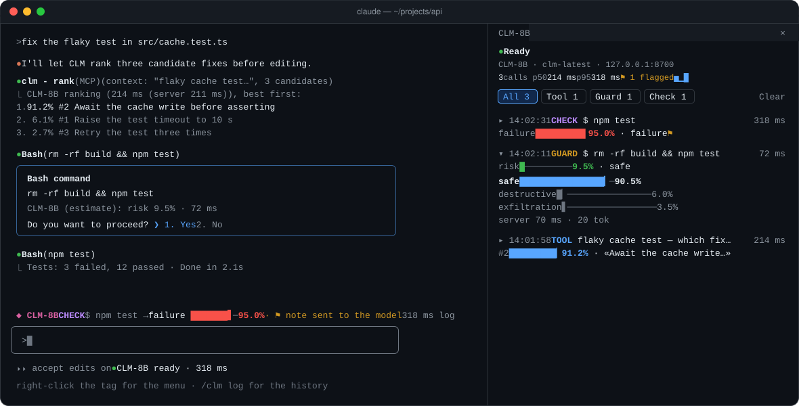
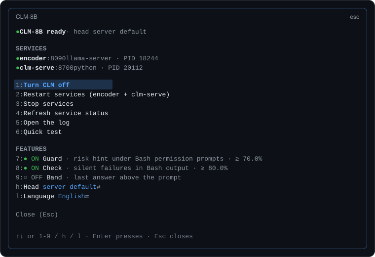
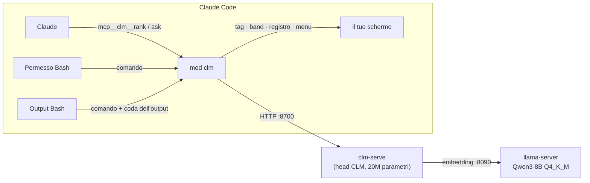

<h1 align="center">◆ CLM-8B per Claude Code</h1>

<p align="center">
  <b>Un secondo parere locale, in millisecondi, dentro Claude Code.</b><br>
  CLM-8B classifica opzioni, stima il rischio dei comandi shell e scova i fallimenti silenziosi,<br>
  tutto sulla tua GPU, tutto visibile in un registro dal vivo.
</p>

<p align="center">
  <a href="LICENSE"></a>
  
  
  <a href="README.md"></a>
</p>

<p align="center">
  
</p>

---

**CLM-8B** ([Contrastive Language Models](https://github.com/Contrastive-LM/CLM)) è un modello *System One*: invece di generare
testo, valuta quanto ogni azione candidata si adatta a uno stato, e risponde in decine di millisecondi. Questa mod lo porta in
Claude Code come verificatore veloce e attivabile a piacere: Claude ottiene due nuovi tool, i permessi Bash ottengono una stima del
rischio, gli output che sembrano a posto ma non lo sono vengono segnalati, e ogni risposta finisce in un registro leggibile.

Tutto gira in locale: la mod parla con `clm-serve` su `127.0.0.1`, che calcola gli embedding con Qwen3-8B tramite `llama-server`.

## Funzioni

| | |
|---|---|
| 🧠 **Due tool per Claude** | `rank` ordina candidati (piani, patch, comandi, file da leggere per primi) rispetto a un contesto; `ask` risponde a domande tipizzate su uno stato: sì/no, una tra più opzioni, o un punteggio su una scala. Entrambi restituiscono la distribuzione completa e la latenza. |
| 🛡️ **Guard** | Quando un comando Bash sta per chiederti il permesso, CLM stima se è *sicuro*, *distruttivo* o di *esfiltrazione*. La stima compare sotto il permesso, e sopra la soglia arriva un toast. Solo consultivo: non cambia mai la decisione. |
| 🔍 **Check** | Dopo un comando Bash che il tool *non* ha segnalato come fallito, un output che sembra un fallimento (test falliti, stack trace, `npm ERR!`) fa arrivare a Claude una breve nota nascosta per rileggerlo. Le letture semplici (`cat`, `grep`, `git log`…) non vengono mai controllate. |
| 📊 **Registro dal vivo** | Due righe per risposta: quando, da dove, su cosa e quanto ci ha messo, poi il numero che conta come indicatore colorato (rischio, fallimento, candidato migliore) con la scelta di CLM. **▸** apre la distribuzione completa. p50/p95, una sparkline delle latenze (un grafico su desktop), filtri per sorgente; quando CLM è spento o offline, la soluzione è a un clic. |
| 🟢 **Tag nel footer e menu** | Un pallino accanto al nome del modello (grigio spento, giallo in verifica, verde pronto, rosso offline): clic per accendere o spegnere, clic destro per il menu. Una band sopra il prompt mostra l'ultima risposta. |
| ⚙️ **Gestione servizi** | Avvia, ferma e ispeziona `llama-server` (l'encoder) e `clm-serve` su questa macchina, trovandoli in LM Studio, nel `PATH` o in pipx. Windows, macOS e Linux. |
| 🧯 **Fatta per non intralciare** | Spenta di default e a costo zero da spenta (i tool sono nascosti al modello). Timeout brevi e un circuit breaker: un encoder lento costa un timeout per pausa, mai uno per comando. |
| 🌍 **Inglese e italiano** | Segue l'impostazione `language` di Claude Code o la lingua del sistema; `/clm lingua` la cambia. |

<p align="center">
  
</p>

## Come funziona



CLM ha un *encoder degli stati* e un *encoder delle azioni* addestrati in modo contrastivo: una domanda è uno stato più un insieme
chiuso di opzioni, e una softmax sui punteggi **è** la distribuzione della risposta. Stati e opzioni vengono codificati una volta
sola e messi in cache, quindi le opzioni ripetute (come le tre categorie del guard) costano un prodotto scalare. Modello, dati e
benchmark sono nel [repository di CLM](https://github.com/Contrastive-LM/CLM).

## Requisiti

- **Claude Code** con le mod (plugin a function hook). Sviluppata e testata sulla 2.1.309, per le superfici terminale e desktop.
- **clm-serve**: `pip install contrastive-lm` (Python 3.10+; va bene anche `pipx install contrastive-lm`). Al primo avvio scarica
  la head di riferimento da 75 MB.
- **llama-server** da [llama.cpp](https://github.com/ggml-org/llama.cpp): `brew install llama.cpp` su macOS, una release su
  Windows o Linux, o semplicemente [LM Studio](https://lmstudio.ai) (la mod trova i suoi backend llama.cpp).
- **Qwen3-8B Q4_K_M** (5,0 GB), l'encoder su cui è addestrato CLM-8B. Circa 6 GB di VRAM; gira anche su CPU, lentamente.

## Installazione

**1. La mod.** Al prompt di una sessione Claude Code nel terminale:

```text
/plugin install clm --marketplace drastiK91/clm-for-claude-code
```

Rispondi `y` per aggiungere il marketplace, poi scegli uno scope (scope utente: tutte le sessioni). Oppure da una shell:

```bash
claude plugin install clm --marketplace drastiK91/clm-for-claude-code
```

Nell'app desktop, dove `/plugin` non è disponibile: clic su **+** accanto al prompt, poi **Plugins**, **Add marketplace** con
`drastiK91/clm-for-claude-code`, poi **Add plugin**.

**2. Il server CLM.**

```bash
pip install contrastive-lm
```

```bash
hf download Qwen/Qwen3-8B-GGUF Qwen3-8B-Q4_K_M.gguf --local-dir ~/.cache/clm/models
```

`hf` arriva con `pip install -U huggingface_hub`. Se LM Studio ha già `Qwen/Qwen3-8B-GGUF` (Q4_K_M), salta il download: la mod
cerca lì per prima cosa.

**3. Avvio.** Da Claude Code, `/clm riavvia` (o `1`/`2` nel menu) avvia entrambi i servizi in background, con i log in
`~/.cache/clm/logs`. Per avviarli a mano:

```bash
llama-server -m ~/.cache/clm/models/Qwen3-8B-Q4_K_M.gguf --embeddings --pooling last -ngl 99 -c 2048 -b 2048 -ub 2048 --host 127.0.0.1 --port 8090 --alias qwen3-8b
```

```bash
clm-serve --host 127.0.0.1 --port 8700 --emb-url http://127.0.0.1:8090/v1/embeddings
```

## Primi passi

```text
/clm on        accende CLM: il pallino diventa giallo, poi verde quando entrambi i servizi rispondono
/clm test      una classifica veloce, per vedere CLM rispondere e quanto è rapido
/clm log       il pannello del registro, con barre, percentili e filtri
/clm           cosa è attivo, in una scheda di stato
```

Poi lavora normalmente. Chiedi a Claude di *"classificare questi tre approcci con CLM"*, o lascia che guard e check facciano la
loro parte da soli. Clic destro sul tag **CLM-8B** nel footer per il menu, in qualsiasi momento.

## Comandi

| Comando | Cosa fa |
|---|---|
| `/clm on` · `off` | Accende CLM (tool, guard, check) o lo spegne (nessuna chiamata a CLM) |
| `/clm` · `stato` | Scheda di stato: server, funzioni, soglie, head |
| `/clm menu` | Servizi e interruttori in un menu (anche: clic destro sul tag nel footer) |
| `/clm registro` · `log` | Il pannello del registro |
| `/clm test` | Una classifica veloce |
| `/clm pulisci` · `clear` | Svuota il registro |
| `/clm riavvia` · `ferma` · `servizi` | Gestisce `llama-server` e `clm-serve` su questa macchina |
| `/clm guard on\|off\|<1-99>` | La stima del rischio, o la soglia del toast in % (predefinita 70) |
| `/clm check on\|off\|<1-99>` | Il controllo dei fallimenti silenziosi, o la sua soglia in % (predefinita 80) |
| `/clm band on\|off` | L'ultima risposta sopra il prompt |
| `/clm modello <nome>\|default` | La head CLM con cui risponde `clm-serve` (ad es. una fine-tuned) |
| `/clm url <url>` | Dove ascolta `clm-serve` (predefinito `http://127.0.0.1:8700`) |
| `/clm encoder <file.gguf>\|default` | Il modello encoder |
| `/clm llama <percorso>\|default` | Il binario di `llama-server` |
| `/clm serve <percorso>\|default` | Il launcher di `clm-serve` |
| `/clm encoder-args <opzioni>\|default` | Opzioni extra per `llama-server` (predefinite `-np 2 -fa on -ctk q8_0 -ctv q8_0`) |
| `/clm tag auto\|button` | Tag nel footer con menu al clic destro, o pulsante semplice |
| `/clm lingua auto\|en\|it` | La lingua della mod |
| `/clm aiuto` | Tutto quanto sopra, dentro Claude Code |

## Configurazione

Le impostazioni sono salvate per utente da Claude Code e sopravvivono ai riavvii; si cambiano con i comandi sopra o dal menu.

| Variabile d'ambiente | |
|---|---|
| `CLM_API_KEY` | Inviata come `Authorization: Bearer …` se impostata, per un `clm-serve` avviato con una chiave (una GPU condivisa). Letta a ogni chiamata; mai salvata, mostrata o registrata. |
| `CLM_BASE_URL` | Usata al posto dell'URL predefinito, come fa il client ufficiale di CLM. Un URL impostato con `/clm url` ha la precedenza. |

Ordine di ricerca quando nessun percorso è impostato:

- **llama-server**: i backend di LM Studio (`~/.lmstudio` e `~/.cache/lm-studio`, prima CUDA 12, prima i più recenti), poi il `PATH`.
- **clm-serve**: il `PATH`, poi `~/.local/bin` di pipx.
- **modello encoder**: `Qwen/Qwen3-8B-GGUF/Qwen3-8B-Q4_K_M.gguf` di LM Studio, poi `~/.cache/clm/models`.

`/clm servizi` mostra cosa è stato trovato e cosa impedisce un riavvio.

## Privacy e sicurezza

- **Locale per impostazione.** La mod parla solo con l'URL configurato, che di default è `127.0.0.1`. I servizi che avvia
  ascoltano solo su `127.0.0.1`, e `/clm encoder-args` rifiuta `--host` e qualsiasi operatore di shell.
- **Cosa vede CLM.** Il guard invia solo il comando (mai la descrizione che ne dà Claude, che potrebbe abbassare il punteggio); il
  check invia l'inizio del comando e gli ultimi ~1.300 caratteri dell'output; i tool inviano ciò che Claude passa loro.
- **Consultiva, mai al comando.** Il guard non consente né nega nulla; il check aggiunge una nota, non cambia l'output. Un errore
  nella mod non si mette mai tra Claude e Bash, e un comando non viene mai eseguito due volte.
- **Ferma solo i propri processi.** `ferma`/`riavvia` fermano `llama-server`, `clm-serve` o un processo Python che esegue clm sulle
  due porte; qualsiasi altro programma su una porta viene segnalato e lasciato stare.
- **Spenta vuol dire spenta.** Da spenta, la mod non fa chiamate a CLM e nasconde i suoi tool al modello.

## Risoluzione dei problemi

| Sintomo | Soluzione |
|---|---|
| Pallino rosso, *clm-serve non raggiungibile* | I servizi non sono attivi: `/clm riavvia`, o avviali a mano (vedi [Installazione](#installazione)). |
| Pallino rosso, *encoder non raggiungibile* | `clm-serve` è attivo ma `llama-server` no; dopo un riavvio il modello impiega ~20 s a caricarsi. Guarda `~/.cache/clm/logs/encoder.log`. |
| *clm-serve non trovato nel PATH* | `pip install contrastive-lm`, oppure indica il tuo venv: `/clm serve C:\percorso\venv\Scripts\clm-serve.exe`. |
| *llama-server non trovato* | Installa llama.cpp o LM Studio, oppure `/clm llama <percorso di llama-server>`. |
| *Modello encoder mancante* | Scaricalo con la riga `hf download` del messaggio, oppure `/clm encoder <percorso del .gguf>`. |
| *porta … occupata da …* | Un altro programma usa la 8090 o la 8700: fermalo, o sposta clm-serve con `/clm url http://127.0.0.1:<porta>`. |
| *guard e check in pausa* | L'encoder è andato in timeout; riprendono da soli (15 s, 30 s, … fino a 5 min). |
| *HTTP 401* | Il server vuole una chiave: imposta `CLM_API_KEY` prima di avviare Claude Code. |

Il registro (`/clm log`) mostra ogni chiamata fallita con il motivo; `claude --debug` mostra cosa ha fatto il motore con ogni hook.

## Sviluppo

Struttura, test e note per contribuire sono nella sezione [Development](README.md#development) del README in inglese. In breve:

```bash
claude plugin validate ./clm-for-claude-code && claude plugin test ./clm-for-claude-code
```

## Crediti e licenza

- [CLM / CLM-8B](https://github.com/Contrastive-LM/CLM) di Contrastive-LM, Apache-2.0: il modello, `clm-serve` e la sua API.
- [Qwen3-8B](https://huggingface.co/Qwen/Qwen3-8B-GGUF) del team Qwen, il backbone dell'encoder.
- [llama.cpp](https://github.com/ggml-org/llama.cpp), che serve gli embedding.

Questa mod è un progetto indipendente, non affiliato ad Anthropic né a Contrastive-LM.

Copyright 2026 Stefano Taccardi. Distribuita con [licenza Apache 2.0](LICENSE).
