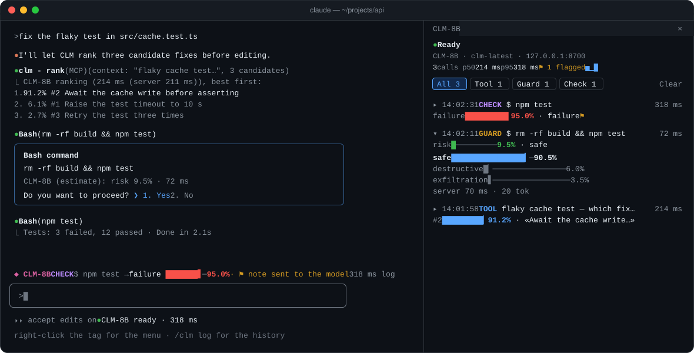
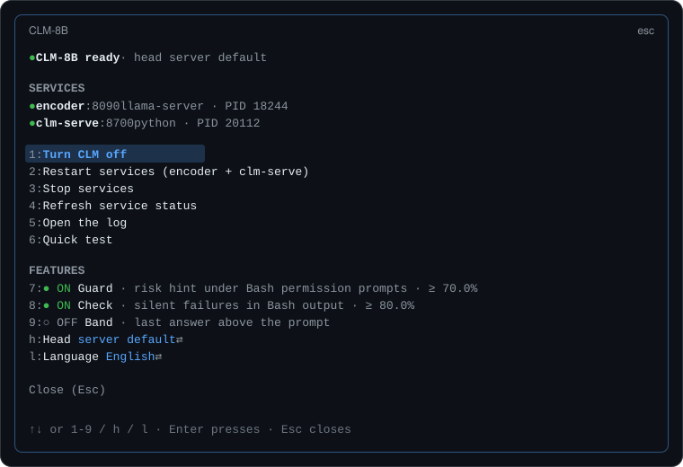
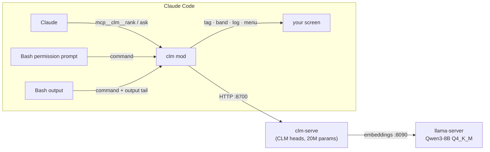

<h1 align="center">◆ CLM-8B for Claude Code</h1>

<p align="center">
  <b>A local, millisecond-fast second opinion for Claude Code.</b><br>
  CLM-8B ranks options, scores risky shell commands and catches silent failures,<br>
  all on your own GPU, all visible in a live log.
</p>

<p align="center">
  <a href="LICENSE"></a>
  
  
  
  <a href="README.it.md"></a>
</p>

<p align="center">
  
</p>

---

**CLM-8B** ([Contrastive Language Models](https://github.com/Contrastive-LM/CLM)) is a *System One* model: instead of
generating text, it scores how well each candidate action fits a state, and answers in tens of milliseconds. This mod plugs it
into Claude Code as a fast, switchable verifier: Claude gets two new tools, your Bash permission prompts get a risk estimate,
outputs that look fine but are not get flagged, and every answer lands in a log you can read.

Everything runs locally: the mod talks to `clm-serve` on `127.0.0.1`, which embeds texts with Qwen3-8B through `llama-server`.

## Contents

- [Features](#features)
- [How it works](#how-it-works)
- [Requirements](#requirements)
- [Install](#install)
- [Quick start](#quick-start)
- [Commands](#commands)
- [Configuration](#configuration)
- [Privacy and safety](#privacy-and-safety)
- [Troubleshooting](#troubleshooting)
- [Development](#development)
- [Credits and license](#credits-and-license)

## Features

| | |
|---|---|
| 🧠 **Two tools for Claude** | `rank` orders candidates (plans, patches, commands, files to read first) against a context, each written as a full sentence (bare words rank poorly); `ask` answers typed questions about a state: yes/no, one of several options, or a score on a scale. Both answer with full probability distributions and their latency. |
| 🛡️ **Guard** | When a Bash command is about to ask for your permission, CLM estimates whether it is *safe*, *destructive* or *exfiltration*. The estimate appears under the prompt, a toast fires above your threshold. Advisory only: it never changes the decision. |
| 🔍 **Check** | After a Bash command that the tool did *not* report as failed, an output that reads like a failure (failed tests, stack traces, `npm ERR!`) earns Claude a short, hidden note to re-read it. Plain reads (`cat`, `grep`, `git log`…) are never checked. |
| 📊 **Live log** | Two lines per answer: when, where from, what about and how long, then the one number it is about as a colored meter (risk, failure, best candidate) with CLM's pick. **▸** opens the whole command (or question) and the full distribution. p50/p95, a latency sparkline (a chart on desktop), filters per source; when CLM is off or offline, the fix is one click away. |
| 🟢 **Footer tag and menu** | A dot beside the model name (grey off, yellow checking, green ready, red offline): click to switch CLM on or off, right-click for the menu. A band above the prompt shows the last answer. |
| ⚙️ **Service manager** | Starts, stops and inspects `llama-server` (the encoder) and `clm-serve` on this machine, finding them in LM Studio, on `PATH` or in pipx. Windows, macOS and Linux. |
| 🧯 **Built to stay out of the way** | Off by default and zero cost when off (the tools are hidden from the model). Short time limits and a circuit breaker: a slow encoder costs one timeout per pause, never one per command. |
| 🌍 **English and Italian** | Follows Claude Code's `language` setting or your system locale; `/clm lang` switches. |

<p align="center">
  
</p>

## How it works



CLM keeps a *state encoder* and an *action encoder* trained contrastively: a question is a state plus a closed set of options, and
a softmax over the scores **is** the answer distribution. States and options are embedded once and cached, so repeated options
(like the guard's three categories) cost a dot product. See the [CLM repository](https://github.com/Contrastive-LM/CLM) for the
model, its training data and its benchmarks.

## Requirements

- **Claude Code** with mods (function-hook plugins). Built and tested on 2.1.309, for the terminal and desktop surfaces.
- **clm-serve**: `pip install contrastive-lm` (Python 3.10+; `pipx install contrastive-lm` works too). It downloads the 75 MB
  reference head on first run.
- **llama-server** from [llama.cpp](https://github.com/ggml-org/llama.cpp): `brew install llama.cpp` on macOS, a release build on
  Windows or Linux, or simply [LM Studio](https://lmstudio.ai) (the mod finds its bundled llama.cpp backends).
- **Qwen3-8B Q4_K_M** (5.0 GB), the encoder CLM-8B is trained on. About 6 GB of VRAM; it runs on CPU too, slowly.

## Install

**1. The mod.** At the prompt of a Claude Code terminal session:

```text
/plugin install clm --marketplace drastiK91/clm-for-claude-code
```

Answer `y` to add the marketplace, then pick a scope (user scope: every session). From a shell instead:

```bash
claude plugin install clm --marketplace drastiK91/clm-for-claude-code
```

In the desktop app, where `/plugin` does not run: click **+** next to the prompt box, then **Plugins**, **Add marketplace** with
`drastiK91/clm-for-claude-code`, then **Add plugin**.

**2. The CLM server.**

```bash
pip install contrastive-lm
```

```bash
hf download Qwen/Qwen3-8B-GGUF Qwen3-8B-Q4_K_M.gguf --local-dir ~/.cache/clm/models
```

`hf` comes with `pip install -U huggingface_hub`. If LM Studio already has `Qwen/Qwen3-8B-GGUF` (Q4_K_M), skip the download:
the mod looks there first.

**3. Start it.** From Claude Code, `/clm restart` (or `1`/`2` in the menu) starts both services in the background, their logs in
`~/.cache/clm/logs`. To run them by hand instead:

```bash
llama-server -m ~/.cache/clm/models/Qwen3-8B-Q4_K_M.gguf --embeddings --pooling last -ngl 99 -c 2048 -b 2048 -ub 2048 --host 127.0.0.1 --port 8090 --alias qwen3-8b
```

```bash
clm-serve --host 127.0.0.1 --port 8700 --emb-url http://127.0.0.1:8090/v1/embeddings
```

## Quick start

```text
/clm on        switch it on: the dot turns yellow, then green once both services answer
/clm test      a quick ranking, to see CLM answer and how fast
/clm log       the log pane, with bars, percentiles and filters
/clm           what is on, as a status card
```

Then just work. Ask Claude to *"rank these three approaches with CLM"*, or let the guard and the check do their part on their own.
Right-click the **CLM-8B** tag in the footer at any time for the menu.

## Commands

| Command | What it does |
|---|---|
| `/clm on` · `off` | Switch CLM on (tools, guard, check) or off (no CLM call of any kind) |
| `/clm` · `status` | Status card: server, features, thresholds, head |
| `/clm menu` | Services and switches in one menu (also: right-click the footer tag) |
| `/clm log` | The log pane |
| `/clm test` | A quick ranking |
| `/clm clear` | Empty the log |
| `/clm restart` · `stop` · `services` | Manage `llama-server` and `clm-serve` on this machine |
| `/clm guard on\|off\|<1-99>` | The risk hint, or its toast threshold in % (default 70) |
| `/clm check on\|off\|<1-99>` | The silent-failure check, or its threshold in % (default 70) |
| `/clm band on\|off` | The last answer above the prompt |
| `/clm model <name>\|default` | The CLM head `clm-serve` answers with (e.g. a fine-tuned one) |
| `/clm url <url>` | Where `clm-serve` listens (default `http://127.0.0.1:8700`) |
| `/clm encoder <file.gguf>\|default` | The encoder model |
| `/clm llama <path>\|default` | The `llama-server` binary |
| `/clm serve <path>\|default` | The `clm-serve` launcher |
| `/clm encoder-args <options>\|default` | Extra `llama-server` options (default `-np 2 -fa on -ctk q8_0 -ctv q8_0`) |
| `/clm tag auto\|button` | Footer tag with a right-click menu, or a plain button |
| `/clm lang auto\|en\|it` | The mod's language |
| `/clm help` | All of the above, in Claude Code |

Italian spellings work too: `riavvia`, `ferma`, `servizi`, `stato`, `registro`, `pulisci`, `aiuto`, `lingua`.

## Configuration

Settings are kept per user by Claude Code and survive restarts; change them with the commands above or from the menu.

| Environment variable | |
|---|---|
| `CLM_API_KEY` | Sent as `Authorization: Bearer …` when set, for a `clm-serve` started with a key (a shared GPU box). Read at each call; never stored, drawn or logged. |
| `CLM_BASE_URL` | Used instead of the default URL, as CLM's own client does. A URL set with `/clm url` wins. |

Discovery order when no path is set:

- **llama-server**: LM Studio's backends (`~/.lmstudio` and `~/.cache/lm-studio`, CUDA 12 first, newest first), then `PATH`.
- **clm-serve**: `PATH`, then pipx's `~/.local/bin`.
- **encoder model**: LM Studio's `Qwen/Qwen3-8B-GGUF/Qwen3-8B-Q4_K_M.gguf`, then `~/.cache/clm/models`.

`/clm services` shows what was found and what stands in the way of a restart.

## Privacy and safety

- **Local by default.** The mod only talks to the URL you configure; out of the box that is `127.0.0.1`. The services it starts
  listen on `127.0.0.1` only, and `/clm encoder-args` refuses `--host` and any shell operator.
- **What CLM sees.** The guard sends the command alone (never Claude's description of it, which could talk the score down); the
  check sends the command's head and the last ~1,300 characters of its output; the tools send what Claude passes them.
- **Advisory, never in charge.** The guard does not allow or deny anything; the check adds a note, it does not change the output.
  A fault in the mod never stands between Claude and Bash, and a command never runs twice.
- **It stops only its own processes.** `stop`/`restart` stop `llama-server`, `clm-serve` or a Python process running clm on the
  two ports; anything else holding a port is reported and left alone.
- **Off means off.** Switched off, the mod makes no CLM call and hides its tools from the model.

## Troubleshooting

| Symptom | Fix |
|---|---|
| Red dot, *clm-serve unreachable* | The services are not running: `/clm restart`, or start them by hand (see [Install](#install)). |
| Red dot, *encoder unreachable* | `clm-serve` is up but `llama-server` is not; the model takes ~20 s to load after a restart. Check `~/.cache/clm/logs/encoder.log`. |
| *clm-serve not found on PATH* | `pip install contrastive-lm`, or point at your venv: `/clm serve /path/to/venv/bin/clm-serve`. |
| *llama-server not found* | Install llama.cpp or LM Studio, or `/clm llama /path/to/llama-server`. |
| *Encoder model missing* | Download it with the `hf download` line the message shows, or `/clm encoder /path/to/model.gguf`. |
| *port … held by …* | Another program uses 8090 or 8700: stop it, or move clm-serve with `/clm url http://127.0.0.1:<port>`. |
| *guard and check paused* | The encoder timed out; they resume by themselves (15 s, 30 s, … up to 5 min). |
| *HTTP 401* | The server wants a key: set `CLM_API_KEY` before starting Claude Code. |

The log (`/clm log`) shows every failed call with its reason; `claude --debug` shows what the engine did with each hook.

## Development

```text
.claude-plugin/
  plugin.json         the manifest
  marketplace.json    makes this repository installable with /plugin install
hooks/
  hooks.json          names the hooks module
  register.tsx        hooks: tools, guard, check, /clm, footer tag, band, menu, log
  services.ts         pure: discovery paths, start/stop scripts, command lines, parsing
  draw.ts             pure: bars, sparkline, percentiles, latency chart
  i18n.ts             what the mod says, in English and Italian
  tag.tsx             the footer tag's surface module (left/right click)
  clm.test.tsx        41 tests against the engine's test kit
types/index.d.ts      the state contract
```

Run it from a working copy and test it:

```bash
claude --plugin-dir ./clm-for-claude-code
```

```bash
claude plugin validate ./clm-for-claude-code && claude plugin test ./clm-for-claude-code
```

The engine writes the API's types into `.claude-plugin/types/` when it loads the mod, so `tsc -p .` type-checks it. On a machine
with hundreds of MCP tools connected, `tsc` may stop with *TS2589 (type instantiation is excessively deep)* on the `tool.call`
hooks: the generated MCP typings are per machine, and the engine's own validation and tests are unaffected.

Contributions are welcome: open an issue first for anything large, keep the tests green, and write what the person reads in
`i18n.ts`, in both languages.

## Credits and license

- [CLM / CLM-8B](https://github.com/Contrastive-LM/CLM) by Contrastive-LM, Apache-2.0: the model, `clm-serve` and its API.
- [Qwen3-8B](https://huggingface.co/Qwen/Qwen3-8B-GGUF) by the Qwen team, the encoder backbone.
- [llama.cpp](https://github.com/ggml-org/llama.cpp), which serves the embeddings.

This mod is an independent project, not affiliated with Anthropic or Contrastive-LM.

Copyright 2026 Stefano Taccardi. Licensed under the [Apache License 2.0](LICENSE).
